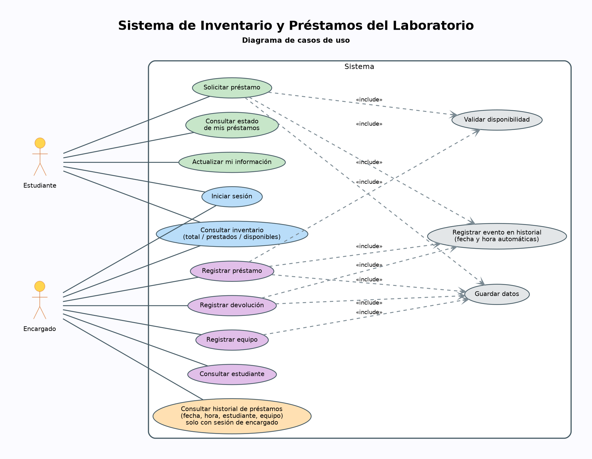
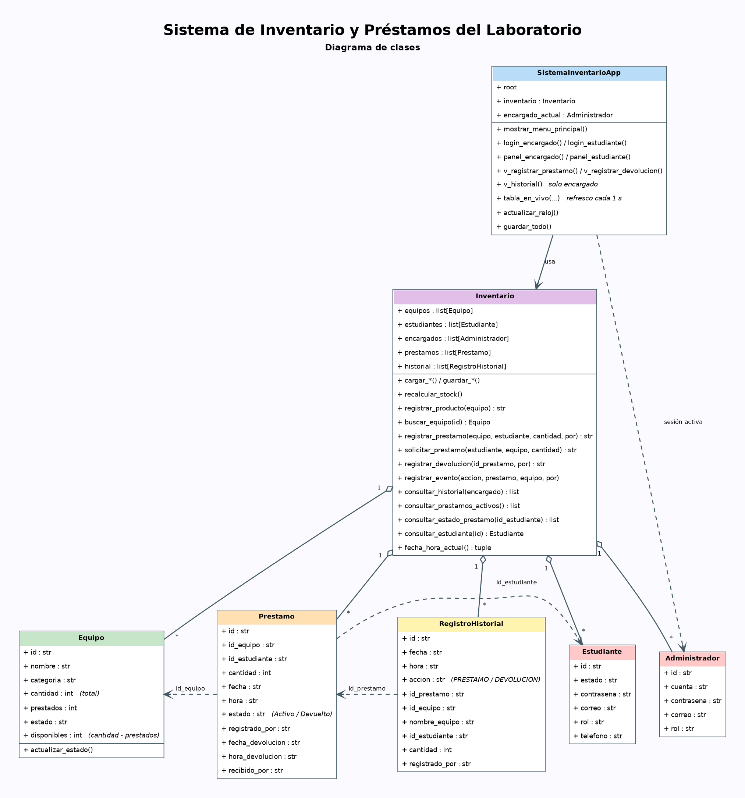

#  Sistema de Inventario y Préstamos del Laboratorio

Sistema desarrollado en Python con interfaz gráfica y manejo de base de datos en archivos planos, diseñado para
gestionar el inventario de equipos, el registro de estudiantes/encargados y el control de préstamos de un laboratorio tecnológico.

---
##  Características Principales

* **Control de Inventario:** Gestión de equipos con conteo automático de cantidades totales, prestadas y disponibles.
* **Roles de Usuario:**
  * **Estudiante:** Puede iniciar sesión, consultar el inventario, solicitar préstamos, ver el estado de sus préstamos y actualizar su información.
  * **Encargado / Administrador:** Control total para registrar equipos, gestionar estudiantes, autorizar/procesar préstamos y devoluciones, y consultar el historial completo de movimientos.
* **Registro Histórico:** Control automático con fecha y hora de cada préstamo y devolución.
* **Persistencia de Datos:** Almacenamiento local mediante archivos de texto estructurados (`.txt`).

---

## Estructura del Proyecto

El repositorio está organizado con los siguientes archivos principales:

| Archivo / Componente | Descripción |
| :--- | :--- |
| `SistemainventarioApp.py` *(o principal)* | Ventana principal y control de la interfaz gráfica de usuario. |
| `inventario.py` | Lógica central del sistema, manejo de reglas de negocio y validaciones. |
| `equipo.py` | Definición de la clase `Equipo` y cálculo de disponibilidad. |
| `Estudiante.py` / `Administrador.py` | Modelos de datos para los usuarios del sistema. |
| `base_de_datos.py` | Gestión de lectura y escritura de archivos planos para persistencia. |
| `equipos.txt`, `estudiantes.txt`, `encargados.txt` | Archivos de texto que sirven como base de datos inicial. |

---

##  Arquitectura y Diagramas del Sistema

### Diagrama de Casos de Uso
El sistema diferencia claramente las acciones permitidas para el rol **Estudiante** frente al rol **Encargado**:
<p align="center">
  
</p>

### Diagrama de Clases
Estructura de clases, atributos, métodos y relaciones principales del proyecto:
<p align="center">
  
</p>

### Diagrama de Secuencia
Flujo detallado para el registro de préstamos, validación de stock y devoluciones:
<p align="center">
  
</p>

---

##  Cómo Ejecutar el Proyecto Localmente

Sigue estos pasos para clonar y poner en marcha el sistema en tu máquina:

### 1. Prerrequisitos
Asegúrate de tener instalado:
* **Python** (versión 3.8 o superior recomendada).

### 2. Clonar el Repositorio
Abre tu terminal y ejecuta el siguiente comando:
```bash
git clone [https://github.com/tu-usuario/tu-repositorio.git](https://github.com/tu-usuario/tu-repositorio.git)
cd tu-repositorio
